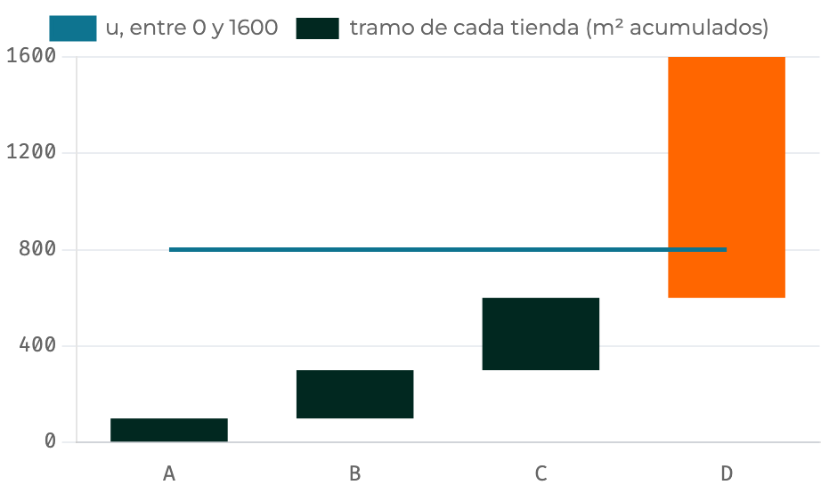
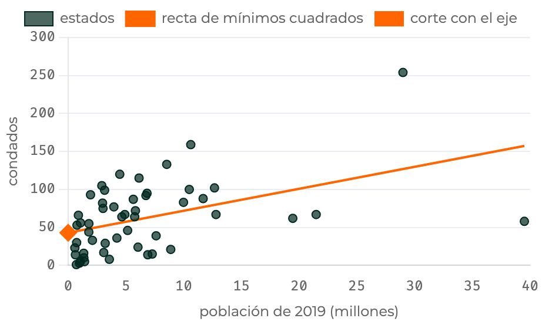

<!--
  Capítulo 6, sesión 1 de 2 (semana 12 del sílabo): módulos 1 a 5, para 90 min de exposición.
  La sesión 2 (semana 13) cubre los módulos 6 a 10. El módulo 11 es cantera de preguntas.

  Convenciones pedidas por Javier (2026-11-02), las mismas del cap. 5:
  - Cada diapositiva con cifras lleva su fuente visible al pie (<small>Fuente: …</small>); los nombres
    internos (cap6_datos.json y sus campos) van en las notas.
  - Las afirmaciones se marcan <mark>Dato</mark> o <kbd>Lectura</kbd>; los juicios del autor van en una caja
    «Opinión del material», y los ejemplos con cifras elegidas o una población inventada, en una caja
    «Ejemplo ilustrativo». Lo que sale de un sorteo con la semilla del capítulo es Dato.
  - Cifras del capítulo tal como las publica (cap. 6 reescrito, T7.104–T7.110); citas a Lohr (3.ª ed.) y a
    Gutiérrez como las da el capítulo.
  - Unos cuatro gráficos animados en las dos sesiones: aquí, las tiendas (módulo 1) y los diseños de
    counties (módulo 5). Los genera precalculo/genera_diapositivas_cap6.py desde cap6_datos.json; las
    fotos de los simuladores, precalculo/fotografia_simuladores_cap6.py (T7.113).
  - Preguntas con las opciones numeradas y la correcta en distinta posición; sus notas empiezan por «Uso».

  El código proyectado sale de los bloques del capítulo, recortado (se dice en las notas); sus salidas son
  las publicadas, que verifica_bloques.py contrasta con la ejecución.
-->

# ¿Por qué probabilidades desiguales? {seccion=modulo-1}

> Cuatro tiendas y una sola visita: con el sorteo de siempre, la estimación del total puede salir 44 o 980; con el proporcional al área, entre 128 y 392.

???
Minuto 0. Abrir con la pregunta: si una tienda hace el 82 % de las ventas del pueblo, ¿tiene sentido darle la misma probabilidad de salir que a la más pequeña? Las cifras del gancho llegan con el gráfico de la diapositiva 7.

## Cada cifra trae su fuente y cada frase dice qué es

::: tarjetas {columnas=3}
### <mark>Dato</mark>
Sale de los datos o del código del capítulo, también de un sorteo con su semilla: se puede recalcular.
### <kbd>Lectura</kbd>
Lo que el material, Lohr o Gutiérrez concluyen de esa cifra: una interpretación.
### Opinión del material
Un juicio o una regla práctica del autor. Va en una caja ámbar con ese título: es defendible, pero no se mide.
:::

Al pie, la **fuente**. Las cifras elegidas a mano y las poblaciones inventadas van en una caja «Ejemplo ilustrativo». Definiciones y fórmulas: teoría, sin marca.

<small>Lohr, S. L. (2022). *Sampling: Design and Analysis* (3.ª ed.). CRC Press. · Gutiérrez, H. A. *Estrategias de muestreo*, cap. 4 (en línea). · Material: capítulo 6, *Probabilidades desiguales*.</small>

???
Explicar la convención una sola vez; es la misma del capítulo 5. Las cifras son las que publica el capítulo, cuyo código vuelve a ejecutar el verificador del material. Las citas a Lohr y a Gutiérrez son las que da el capítulo. Los bloques de código del capítulo forman una sola sesión de R: para correr el de una diapositiva hay que ejecutar antes los anteriores (el del módulo 1 carga `survey` y `sampling`), y el pie de cada código dice qué objetos toma de ellos.

## Cuando las unidades son muy distintas, sortearlas por igual desperdicia lo que ya se sabe {columnas=1:1}

| Tienda | Área \(x_i\) (m²) | Ventas \(t_i\) (miles de USD) |
|---|---|---|
| A | 100 | 11 |
| B | 200 | 20 |
| C | 300 | 24 |
| D | 1000 | 245 |
| **Total** | 1600 | 300 |

|||

- <mark>Dato</mark> D tiene diez veces el área de A y hace el 82 % de las ventas
- Se quiere el total de ventas del mes. El área es la **medida de tamaño**: se conoce para todo el marco antes de muestrear; las ventas, solo de la tienda que salga
- **PPT:** cada unidad sale con probabilidad proporcional a su tamaño, \(\psi_i = x_i/t_x\), con \(t_x = \sum x_i = 1600\)

<small>Fuente: cap. 6, módulo 1 (y su nota «La medida de tamaño»); Lohr 3.ª ed., §6.1 y Tabla 6.1.</small>

???
Lohr presenta en §6.1 este pueblo de cuatro supermercados: se quiere el total de ventas del último mes visitando una sola tienda. En el ejemplo se conocen las ventas de las cuatro solo para poder calcular todo lo que el sorteo podría dar; en una encuesta real solo se verían las de la tienda que saliera. 82 % es 245/300. Al final del capítulo 5 pasaba lo mismo: Texas con 254 condados y Delaware con 3.

## Se divide lo observado entre su probabilidad de salir

::: definicion Probabilidad de selección \(\psi_i\) y su estimador
En un sorteo de **una extracción**, \(\psi_i\) es la probabilidad de que salga la unidad \(i\); las \(\psi_i\) del marco suman 1. Si sale \(i\), el total se estima con \(\hat{t}_\psi = t_i/\psi_i\).
:::

- A ocupa 100 de los 1600 m²: \(\psi_A = 1/16\)
- Si sale A, sus ventas valen por las de 16 «tiendas como A»: \(16 \times 11 = 176\)
- Cada dato lleva el peso \(1/\psi_i\), el de siempre

<small>Fuente: cap. 6, módulo 1 (definición y tabla de las cuatro tiendas).</small>

???
Preguntar qué estimación da D: 245/0,625 = 392. Con una sola extracción, \(\psi_i\) es la \(\pi_i\) del capítulo 2 y \(1/\psi_i\) es el peso de siempre; con varias extracciones dejan de coincidir, y eso es el módulo 4. Transición: ¿qué tal estima este sorteo comparado con el de probabilidades iguales?

## Los dos sorteos son insesgados; el proporcional tiene 10,8 veces menos varianza {columnas=3:2}

{alto=400}

|||

- <mark>Dato</mark> \(E(\hat{t}) = 300\) con los dos sorteos
- <mark>Dato</mark> \(V = 14\,248\) con \(\psi \propto\) área; \(154\,488\) con \(\psi = 1/4\)
- <kbd>Lectura</kbd> elegir las \(\psi\) no toca el sesgo: decide la varianza

<small>Fuente: cap. 6, módulo 1, bloque «Las cuatro tiendas: dos sorteos enumerados exactos».</small>

???
Dos pasos: primero las barras del sorteo proporcional, todas cerca de la línea de 300; después las del sorteo uniforme, de 44 a 980. Insesgado con cualquier ψ positiva: \(E = \sum_i \psi_i\,t_i/\psi_i = \sum_i t_i\), cada \(\psi_i\) se cancela con la que divide. La varianza es la suma de \(\psi_i(t_i/\psi_i - 300)^2\): 961 + 2450 + 5547 + 5290 = 14 248. La razón 154 488/14 248 es 10,8. Las barras son `tiendas.estPpt` y `estIgual` de `cap6_datos.json`, el precálculo del capítulo, redibujadas. Si hay tiempo, abrir el simulador del módulo 1.

## ¿De dónde sale exactamente la ganancia de 10,8? {.pregunta}

Con las cuatro tiendas, los dos sorteos son insesgados, pero el proporcional tiene 10,8 veces menos varianza. ¿Por qué?

1. Con \(\psi \propto\) tamaño, los cocientes \(t_i/\psi_i\) quedan cerca de 300
2. El proporcional saca la tienda D más a menudo, y D es la que más informa
3. Las probabilidades desiguales eliminan el sesgo de selección del sorteo uniforme

::: respuesta
La 1: 176, 160, 128 y 392, frente a 44, 80, 96 y 980. La 2 confunde observar más con estimar mejor. La 3: no había sesgo que eliminar.
:::

<small>Fuente: cap. 6, módulo 11, pregunta 1 de la autoevaluación.</small>

???
**Uso:** un minuto, por escrito; después, revelar. El gráfico anterior muestra las barras, pero no dice por qué. La 2 falla porque cada muestra sigue siendo una tienda. Son tres de las cuatro opciones del material, sin letras (el material las baraja). La cuarta culpa a la corrección por población finita; se puede mencionar en voz alta: no pinta nada, porque los dos sorteos son de una extracción. La idea clave siguiente generaliza la respuesta.

## La varianza es pequeña cuando \(t_i/\psi_i\) cambia poco de una unidad a otra {.idea etiqueta="Idea clave · la idea central del capítulo"}

Eso ocurre cuando la probabilidad de cada unidad acompaña a su valor. Sin reemplazo, desde el módulo 4, la misma idea se escribe con \(y_k/\pi_k\).

???
Toda la sesión vuelve a esta frase: el Hansen–Hurwitz, el πPT, el criterio de Raj y, en la sesión 2, el elefante. Aquí ocurre porque las ventas crecen con el área.

## Sin el peso de cada dato, la estimación pasa del doble

<mark>Dato</mark> Si se sortea con \(\psi \propto\) área pero se expande como si todas tuvieran 1/4, con \(4\,t_i\), la estimación vale en promedio

$$\sum_i \psi_i \cdot 4\,t_i = 643{,}25 \qquad \text{en vez de } 300$$

- <kbd>Lectura</kbd> las unidades grandes salen más a menudo; sin su peso \(1/\psi_i\), se cuentan de más

<small>Fuente: cap. 6, módulo 1 (advertencia «El precio: cada dato lleva su peso» y última salida del bloque del módulo).</small>

???
El material dice que esta regla acompaña todo el capítulo. La medida de tamaño gana cuando es aproximadamente proporcional a la variable de interés, como el área y las ventas; los módulos 5 y 8 muestran qué pasa cuando no lo es. Se puede añadir de palabra: la razón del capítulo 3 usa \(x\) al estimar; PPT la usa al diseñar el sorteo. Transición: con una sola tienda la estimación depende mucho de cuál salga; el módulo 2 observa varias.

# El estimador de Hansen–Hurwitz {seccion=modulo-2}

> Repetir el sorteo n veces, con reemplazo, y promediar: la varianza se divide entre n y se estima con la cuenta de siempre.

???
Minuto 19. Pregunta de arranque: con una tienda la estimación depende mucho de cuál salga; ¿cómo se reduce esa variación sin perder lo ganado con las ψ?

## Hansen–Hurwitz (HH) promedia \(n\) estimaciones independientes, una por extracción

$$\hat{t}_{HH} = \frac{1}{n}\sum_{j=1}^{n} z_j, \qquad z_j = \frac{t_i}{\psi_i} \ \text{ si en la extracción } j \text{ salió } i$$

$$V(\hat{t}_{HH}) = \frac{1}{n}\sum_{i=1}^{N} \psi_i\left(\frac{t_i}{\psi_i} - t\right)^2 \qquad\qquad \widehat{V}(\hat{t}_{HH}) = \frac{s_z^2}{n}$$

- Cada \(z_j\) es la estimación del módulo 1: su promedio es insesgado
- \(V\) recorre todo el marco: sirve para el cálculo exacto
- \(\widehat{V}\) es \(s^2/n\) con los \(z_j\): las extracciones son independientes

<small>Fuente: cap. 6, módulo 2 (fórmula); Lohr 3.ª ed., §6.2; Gutiérrez, Resultado 4.2.4.</small>

???
Hansen y Hurwitz lo propusieron en 1943. El índice \(j\) recorre las extracciones (si una tienda sale dos veces, aparece dos veces); el índice \(i\), las unidades del marco. Se escribe \(t_i\) porque, cuando la unidad es una UPM, su valor es un total: hace el papel de la \(y_k\) del capítulo 2. Con varias extracciones, \(\psi_i\) sigue siendo la probabilidad de salir en cada una, pero ya no la de estar en la muestra.

## Con dos extracciones, la varianza baja a la mitad: 7124 {columnas=2:1}

```r Hansen-Hurwitz con dos extracciones, enumerado {resaltar=4-8}
pares <- expand.grid(prima = 1:4, segunda = 1:4)
pares$prob <- tiendas$psi[pares$prima] * tiendas$psi[pares$segunda]
pares$hh <- (est_ppt[pares$prima] + est_ppt[pares$segunda]) / 2
c(E_HH = sum(pares$prob * pares$hh),
  V_enumerada = sum(pares$prob * (pares$hh - t_total)^2),
  V_formula = sum(tiendas$psi * (est_ppt - t_total)^2) / 2)
#>        E_HH V_enumerada   V_formula
#>         300        7124        7124
```

|||

- <mark>Dato</mark> los 16 pares ordenados y la fórmula dan 7124, la mitad de 14 248
- <kbd>Lectura</kbd> las dos extracciones son independientes: por eso la varianza se divide entre \(n\)

<small>Fuente: cap. 6, módulo 2, bloque «Hansen-Hurwitz enumerado y sorteado» (pestaña R, primera parte). Usa `tiendas`, `est_ppt` y `t_total`, del bloque del módulo 1.</small>

???
Proyectar. Recortado: se quitan los comentarios y la línea de \(\psi_D^2\). Son 16 pares porque con reemplazo el orden cuenta y la misma tienda puede repetirse: D sale en las dos extracciones con probabilidad \(0{,}625^2 \approx 0{,}39\), y entonces se cuenta dos veces; eso es lo que mantiene la independencia. `est_ppt` son los cuatro cocientes del módulo 1: 176, 160, 128 y 392.

## Con una muestra, el error estándar estimado es 132; el verdadero, 84 {columnas=3:2}

```r Una muestra de dos extracciones {resaltar=4,6-8}
set.seed(2026)
s <- sample(1:4, 2, replace = TRUE, prob = tiendas$psi)
paste(tiendas$tienda[s], collapse = "")
#> [1] "CD"
z <- tiendas$ventas[s] / tiendas$psi[s]
c(t_hat = mean(z), ee_estimado = sqrt(var(z) / 2))
#>       t_hat ee_estimado
#>         260         132
```

|||

- <mark>Dato</mark> la muestra CD estima 260, con un error estándar (ee) estimado de 132
- <mark>Dato</mark> el verdadero es \(\sqrt{7124} \approx 84\)
- <kbd>Lectura</kbd> con dos datos, \(s_z^2\) es poco fiable; el estimador puntual ya usa bien los tamaños

<small>Fuente: cap. 6, módulo 2, bloque «Hansen-Hurwitz enumerado y sorteado» (pestaña R, segunda parte). Usa `tiendas`, del bloque del módulo 1.</small>

???
Proyectar. La pestaña Python sortea con la misma semilla, pero numpy usa otro generador y le salen B y D (276): coinciden las cifras exactas, 14 248 y 7124. Esto vuelve en el ejercicio 1 de la tarea: con pocas extracciones, un ee estimado engaña. Cómo hace R el sorteo es la sección siguiente.

## ¿Cuántas extracciones bastan para una varianza menor que 1000? {.pregunta}

Con las tiendas, \(V(n = 1) = 14\,248\), y la varianza del HH es \(V(n = 1)/n\). ¿Cuál es el menor \(n\) entero?

::: respuesta
**15.** Hay que pedir \(14\,248/n < 1000\), es decir, \(n > 14{,}248\): con 14 extracciones la varianza queda en 1017,7, y con 15, en 949,9.
:::

<small>Fuente: cap. 6, módulo 11, pregunta 2 de la autoevaluación.</small>

???
**Uso:** dos minutos, en papel; después, revelar. Es la pregunta numérica del material (respuesta 15). Las dos varianzas, 1017,7 y 949,9, son la cuenta de la diapositiva (14 248/14 y 14 248/15), no salen escritas en el material. Si alguien responde 14, mostrar que \(14\,248/14\) todavía pasa de 1000.

# Cómo se sortea: acumulativo y Lahiri {seccion=modulo-3}

> Para sortear con probabilidades desiguales hace falta un algoritmo: una receta que convierta uniformes en unidades con las \(\psi\) pedidas.

???
Minuto 30. El bloque del módulo 2 sorteó con `sample(..., prob = psi)` sin decir cómo; esta sección abre esa caja.

## El acumulativo: cada unidad ocupa un tramo tan largo como su tamaño {columnas=3:2}



|||

1. Acumular los tamaños: A 1⁠–⁠100, B 101⁠–⁠300, C 301⁠–⁠600, D 601⁠–⁠1600
2. Sortear \(u\) entre 0 y \(t_x = 1600\)
3. Sale la unidad en cuyo tramo cae \(u\)

<mark>Dato</mark> D ocupa 1000 de 1600 puntos: sale el 62,5 % de las veces.

**Costo:** recorrer el marco entero antes del primer sorteo.

<small>Fuente: cap. 6, módulo 3 (método acumulativo, Hansen, Hurwitz y Madow, 1953); Lohr 3.ª ed., §6.2.1; Gutiérrez, §4.2.1.</small>

???
A mano, del material: \(u = 224{,}2\) cae en B y \(u = 1117{,}9\) en D; en los cinco sorteos del bloque, D sale tres veces, porque es con reemplazo. Con 100 000 sorteos, las frecuencias del bloque (0,0627, 0,1248, 0,1873 y 0,6252) clavan las ψ. La foto es el simulador en su estado inicial; en vivo se puede mover \(u\).

## Lahiri: se acepta la candidata con probabilidad \(x_i/x_{\max}\)

::: flujo
1. **Candidata** — una unidad al azar, todas con probabilidad \(1/N\)
2. **Uniforme** — \(u\) entre 0 y \(x_{\max} = 1000\), al menos el mayor tamaño
3. **Decidir** — si \(u \le x_i\), sale; si no, se vuelve al paso 1
:::

- <mark>Dato</mark> en un intento: A 0,025, B 0,05, C 0,075 y D 0,25; suman 0,4
- Entre las aceptadas, D sale \(0{,}25/0{,}4 = 0{,}625\) de las veces: su \(\psi_D\)
- **Costo:** \(1/0{,}4 = 2{,}5\) intentos por selección; <mark>Dato</mark> el bloque mide 2,51

<small>Fuente: cap. 6, módulo 3 (método de Lahiri, 1951, y su bloque); Lohr 3.ª ed., §6.2.1; Gutiérrez, §4.2.1.</small>

???
Por qué funciona: en cada intento una tienda sale si es la candidata (1/4) y se acepta (\(x_i/1000\)); el producto es proporcional al área. No hay que acumular nada: basta poder consultar el tamaño de cualquier unidad por su número. Es el muestreo por rechazo (*rejection sampling*) que usan también los generadores de números aleatorios. En la práctica, `sample()` de R sortea por el acumulativo con pocas unidades y, con más de 200, por el método del alias de Walker.

## Un marco de 40 millones que no cabe en memoria: ¿qué método? {.pregunta}

No se puede recorrer antes de sortear, pero se puede leer cualquier unidad por su número, y se conocen \(N\) y \(x_{\max}\).

1. El acumulativo, porque es exacto y Lahiri solo aproxima las \(\psi\)
2. Lahiri, porque al rechazar las unidades pequeñas tiene menos varianza
3. Lahiri: sortea entre 1 y \(N\) y acepta o rechaza contra \(x_{\max}\)

::: respuesta
La 3: el acumulativo exige sumar todo el marco antes del primer sorteo. Los dos son exactos y tienen la misma varianza; la diferencia es de memoria y de pasadas.
:::

<small>Fuente: cap. 6, módulo 11, pregunta 3 de la autoevaluación.</small>

???
**Uso:** un minuto, voto a mano alzada; después, revelar. Son tres de las cuatro opciones del material. Si las unidades llegaran una a una y hubiera que decidir en el momento (transacciones que se auditan mientras ocurren), no serviría ninguno de los dos: para eso está el diseño de Poisson, primer tema de la sesión 2.

# Sin reemplazo: Horvitz–Thompson otra vez {seccion=modulo-4}

> Quitar el reemplazo no pide teoría nueva: el HT del capítulo 2 vale igual. Pero quitarlo no basta para ganar.

???
Minuto 38. Con reemplazo la misma tienda puede salir dos veces, y la segunda vez no informa nada nuevo. Lo natural es sortear dos tiendas distintas.

## El HT del capítulo 2 sirve con cualquier diseño con \(\pi_k > 0\)

$$\hat{t}_\pi = \sum_{k \in s} \frac{y_k}{\pi_k}, \qquad E(\hat{t}_\pi) = \sum_{k \in U} \frac{y_k}{\pi_k}\,E(I_k) = \sum_{k \in U} \frac{y_k}{\pi_k}\,\pi_k = t$$

- \(I_k\) vale 1 si \(k\) sale y 0 si no: \(E(I_k) = \pi_k\)
- \(\pi_k\) es la suma de \(p(s)\) sobre las muestras que contienen a \(k\); con tamaño fijo, suman \(n\)
- El MAS es el caso \(\pi_k = n/N\); nada obliga a que sean iguales
- Desde aquí: valor \(y_k\) e índice \(k\), como en el capítulo 2

<small>Fuente: cap. 6, módulo 4 (fórmula); Lohr 3.ª ed., §6.4; Gutiérrez, §4.3.</small>

???
La letra \(i\) queda para las extracciones con reemplazo, junto a \(\psi_i\), y para las clases del módulo 9. Lo que separa los dos mundos no es la letra del índice: es \(\psi\) frente a \(\pi\).

## Con \(p(s) \propto x_k + x_l\), el HT de las tiendas tiene más varianza que el HH {columnas=2:1}

```r Seis parejas sin reemplazo {resaltar=5-6,8-12}
muestras <- t(combn(4, 2))
p_s <- tiendas$m2[muestras[, 1]] + tiendas$m2[muestras[, 2]]
p_s <- p_s / sum(p_s)
pi_k <- sapply(1:4, function(k) sum(p_s[apply(muestras == k, 1, any)]))
round(pi_k, 4)
#> [1] 0.3750 0.4167 0.4583 0.7500
ht_s <- apply(muestras, 1, function(m) sum(tiendas$ventas[m] / pi_k[m]))
c(E_HT = sum(p_s * ht_s), V_HT = sum(p_s * (ht_s - t_total)^2))
#>     E_HT     V_HT
#>   300.00 15025.67
round(tiendas$ventas / pi_k, 1)
#> [1]  29.3  48.0  52.4 326.7
```

|||

- <mark>Dato</mark> \(\pi_k\) de 0,375 a 0,75; el HT es insesgado y \(V = 15\,026\)
- <mark>Dato</mark> más del doble que el HH con reemplazo (7124), con el mismo \(n\)
- <kbd>Lectura</kbd> el cociente de D, 326,7, queda lejísimos de los otros tres

<small>Fuente: cap. 6, módulo 4, bloque «Espacio de muestras sin reemplazo» (pestaña R). Usa `tiendas` y `t_total`, del bloque del módulo 1.</small>

???
Proyectar. Recortado: se quitan los comentarios, el `sum(p_s)` (4800), la tabla de las \(p(s)\), la suma de las \(\pi\) y los seis HT. A mano: \(p(AB) = 300/4800 = 0{,}0625\), y \(\pi_A = 0{,}0625 + 0{,}0833 + 0{,}2292 = 0{,}375\); si sale AB, el HT vale 77,3. La mayor \(\pi\) es el doble de la menor, mientras que las ventas de D son más de veinte veces las de A. En el HH, el papel de la \(\pi\) lo hace \(n\psi_i\): sus cocientes son 88, 80, 64 y 196, mucho más parecidos.

## ¿Qué probabilidad tiene D de estar en la muestra? {.pregunta}

Se sortean dos tiendas con reemplazo, con \(\psi_D = 0{,}625\).

1. 1,25, que es \(n\,\psi_D = 2 \times 0{,}625\)
2. 0,625, que es \(\psi_D\)
3. 0,75, la \(\pi_D\) del diseño sin reemplazo con \(p(s) \propto x_k + x_l\)
4. 0,8594, que es \(1 - (1 - 0{,}625)^2\)

::: respuesta
La 4: uno menos la probabilidad de que D no salga en ninguna. La 1 es el número medio de veces que sale D; la 2, la de una extracción; la 3, la de otro diseño.
:::

<small>Fuente: cap. 6, módulo 11, pregunta 4 de la autoevaluación.</small>

???
**Uso:** un minuto, por escrito; después, revelar. Son las cuatro opciones del material, en otro orden. Es la confusión que la diapositiva siguiente pone en una tabla.

## Dos probabilidades que no hay que confundir: \(\psi\) y \(\pi\)

|  | Con reemplazo | Sin reemplazo |
|---|---|---|
| Probabilidad | \(\psi_i\): salir en **una extracción** | \(\pi_k\): estar **en la muestra** |
| Suman | 1 | \(n\), con tamaño fijo |
| Peso de cada dato | \(1/(n\,\psi_i)\) | \(1/\pi_k\) |

- <mark>Dato</mark> \(\pi \approx n\,\psi\) solo si \(\psi\) es pequeña. A: \(n\psi = 0{,}125\) y \(\pi = 0{,}121\); D: \(n\psi = 1{,}25\) y \(\pi = 0{,}859\)
- Esa aproximación permite analizar un diseño sin reemplazo como si fuera con reemplazo (sesión 2)

<small>Fuente: cap. 6, módulo 4 (definición, tabla y bloque «psi frente a pi con las cuatro tiendas»).</small>

???
El material afirma que confundirlas es el error más común del capítulo: es una opinión del autor, defendible, y se puede decir así en voz alta. Lohr escribe \(\psi_i\) y \(\pi_i\) con valores \(t_i\); Gutiérrez, \(p_k\) y \(\pi_k\) con valores \(y_k\). La tabla completa de notación abre el módulo 11. La aproximación \(\pi \approx n\psi\) es la que usan los módulos 7 y 9.

## En estas tiendas, la varianza baja cuando el diseño deja fuera a D con menos probabilidad

| Diseño, \(n = 2\) | Prob. sin D | \(V\) de las muestras sin D | \(V\) |
|---|---|---|---|
| \(p(s) \propto x_k + x_l\) | 0,25 | 75 % | 15 026 |
| Hansen–Hurwitz, con reemplazo | 0,14 | 47 % | 7124 |
| Lohr, extracción a extracción | 0,10 | 89 % | 4384 |
| πPT (lo construye el módulo 5) | 0 | — | 53 |

<kbd>Lectura</kbd> Sin reemplazo no es automáticamente mejor: con las mismas tiendas, un diseño sin reemplazo queda por encima del HH y otro por debajo.

<small>Fuente: cap. 6, módulo 4, bloque «El diseño de Lohr, extracción a extracción» y su tabla; Lohr 3.ª ed., ejs. 6.8 y 6.9.</small>

???
Una muestra sin D da un HT muy por debajo de 300 (entre 77 y 176 en los tres diseños), y la varianza baja a medida que esas muestras se vuelven raras. El diseño de Lohr sortea la primera tienda con ψ y la segunda entre las que quedan con \(\psi_l/(1 - \psi_k)\); Lohr lo atribuye a Yates y Grundy (1953). Sus \(\pi\): 0,19, 0,37, 0,54 y 0,90. El HH tiene además un precio propio: puede sacar D dos veces y estimar 392, y esa sola muestra aporta el 46 % de su varianza. Transición: la fila del πPT, con varianza 53, es el gancho del módulo 5.

# El diseño πPT y cuándo gana {seccion=modulo-5}

> Se piden las \(\pi\) directamente, proporcionales al tamaño. Si \(y\) acompaña a \(x\), la varianza se anula; si no, el diseño puede perder contra el MAS.

???
Minuto 53. En el módulo 4 el diseño venía dado y de él salían las \(\pi\); aquí se invierte el camino: se eligen las \(\pi\) y se busca un sorteo que las respete.

## πPT: \(\pi_k = n\,x_k/t_x\), y la unidad que pase de 1 entra siempre

$$\pi_k = n\,\frac{x_k}{t_x}$$

::: definicion Inclusión forzosa
Si \(n\,x_k/t_x > 1\), la unidad entra en todas las muestras: \(\pi_k = 1\), y no aporta varianza. Los cupos que quedan se reparten entre las demás en proporción a su tamaño; si otra pasa de 1, se repite el paso.
:::

- <mark>Dato</mark> tiendas, \(n = 2\): D forzosa; \(\pi_A = 1/6\), \(\pi_B = 1/3\), \(\pi_C = 1/2\)
- <mark>Dato</mark> tres muestras posibles, {A, D}, {B, D} y {C, D}, con HT de 311, 305 y 293: \(V = 53\)

<small>Fuente: cap. 6, módulo 5, bloque «El piPT con las cuatro tiendas»; Gutiérrez, §4.3 (ej. 4.3.1); Lohr 3.ª ed., §6.4.</small>

???
Si \(y_k\) fuera proporcional a \(x_k\), todos los cocientes \(y_k/\pi_k\) serían iguales y la varianza sería cero: la idea central llevada al extremo. En las tiendas, la \(\pi\) cruda de D sería 1,25; con D forzosa, el otro cupo se reparte sobre 600 m². Los cocientes de A, B y C son 66, 60 y 48, y el de D no cambia nunca. 53, frente a 7124 del HH y 15 026 y 4384 de los diseños del módulo 4. Es el estrato que se censa entero del capítulo 4. Gutiérrez lo llama πPT; Lohr, *pps* sin reemplazo.

## statepps: 51 estados, \(n = 10\), y California entra siempre {columnas=2:1}

```r Las pi del diseño y la inclusión forzosa
statepps <- read.csv("CSV data sets for SDA 3e/statepps.csv")
c(estados = nrow(statepps), total_condados = sum(statepps$counties))
#>        estados total_condados
#>             51           3143
round(10 * max(statepps$pop2019) / sum(statepps$pop2019), 4)
#> [1] 1.2038
pi_st <- inclusionprobabilities(statepps$pop2019, 10)
statepps$state[pi_st >= 1 - 1e-12]
#> [1] "California"
```

|||

- **Los datos:** los 50 estados y el Distrito de Columbia; tamaño \(x\) = población de 2019; interés: `counties` (3143 en total) y `waterarea`, la superficie de agua
- <mark>Dato</mark> la \(\pi\) cruda de California es 1,2038: queda forzosa, y los 9 cupos restantes se reparten entre los otros 50

<small>Fuente: cap. 6, módulo 5, bloque «Las pi del diseño y la inclusión forzosa» (recortado); statepps.csv (Lohr 3.ª ed.). `inclusionprobabilities` es del paquete `sampling`.</small>

???
Proyectar. `inclusionprobabilities` calcula \(n\,x_k/t_x\), trunca en 1 y reparte el sobrante, sin avisar: por eso el bloque imprime antes la \(\pi\) cruda. Como los totales verdaderos se conocen, se puede medir cuánto se equivoca cada diseño. Se quitó la línea que comprueba que las \(\pi\) suman 10.

## El sistemático sortea las \(\pi\) con un solo arranque, pero depende del orden

::: flujo
1. **Acumular** — las \(\pi\) en el orden de la lista; tiendas: 1/6, 1/2, 1 y 2
2. **Arrancar** — un solo \(u\) uniforme entre 0 y 1; tiendas: \(u = 0{,}4\)
3. **Tomar** — las unidades cuyos tramos contienen \(u, u + 1, \dots\): B y D
:::

- <mark>Dato</mark> con la lista alfabética, 830 de las 1225 parejas de estados no forzosos nunca salen juntas: su probabilidad conjunta \(\pi_{kl}\) es 0
- Brewer sortea las mismas \(\pi\) con todas las \(\pi_{kl} > 0\); Sunter, el tercer algoritmo del módulo, vuelve en el ejercicio 5

<small>Fuente: cap. 6, módulo 5 (algoritmos y bloque «El mismo piPT con distintos algoritmos»); Gutiérrez, §4.4.</small>

???
Sistemático, con las tiendas: \(u = 0{,}4\) cae en B y \(u + 1 = 1{,}4\) en D. Funciona porque cada tramo mide \(\pi_k \le 1\) y contiene a lo sumo un punto. Sus dos defectos: la varianza depende del orden de la lista, y sin \(\pi_{kl} > 0\) no hay estimador insesgado de la varianza (sesión 2). Las 1225 parejas son las de los 50 estados no forzosos; 828 con la lista por población. Los otros dos algoritmos, de palabra. **Brewer** (\(n = 2\)): la primera unidad con probabilidad proporcional a \(x_k(t_x - x_k)/(t_x - 2x_k)\); la segunda, entre las restantes, proporcional a \(x_k\); `UPbrewer` lo extiende a cualquier \(n\). **Sunter**: se recorre la lista de mayor a menor \(\pi\), y cada unidad entra con su umbral, \(\pi_k(n - e_k)/(n - A_k)\), donde \(e_k\) es cuántas van elegidas y \(A_k\) la suma de las \(\pi\) anteriores; con las tiendas sale {C, D} con 1/2, {B, D} con 1/3 y {A, D} con 1/6. Reproduce las \(\pi\) pedidas mientras ningún umbral pase de 1; si alguno se pasa, la unidad entra seguro y las \(\pi\) de las más pequeñas se apartan un poco de las pedidas (Gutiérrez, Resultado 4.4.3, da las \(\pi\) que resultan). Tillé, máxima entropía y la escisión están en el «Para profundizar» del módulo 5: no se exponen.

## Antes de muestrear, el criterio de Raj dice si el PPT gana

$$V_{MRAS} - V_{PPT} = \frac{N^2}{n}\,\mathrm{Cov}\!\left(x,\ \frac{y^2}{x}\right)$$

- **MRAS:** MAS con reemplazo; **PPT:** con reemplazo y \(\psi_i = x_i/t_x\)
- Cuenta el **signo** de la covarianza de la población (divisor \(N\)). Pide \(y\) de todo el marco: en la práctica, de un censo anterior o de una variable parecida
- <mark>Dato</mark> tiendas, \(n = 2\): \(\dfrac{16}{2} \times 8765 = 70\,120 = 77\,244 - 7124\); gana el PPT

<small>Fuente: cap. 6, módulo 5 (fórmula y bloque «El criterio de Raj sobre los estados»); Gutiérrez, Resultado 4.2.7, y su lectura geométrica, citando a Lehtonen y Pahkinen.</small>

???
Con \(n = 2\), el PPT es el HH de las tiendas. Los \(y^2/x\) de las tiendas son 1,21, 2, 1,92 y 60: D, la más grande, tiene también el mayor. El criterio es exacto con reemplazo y orientativo para el πPT. Lo del censo anterior no lo dice el capítulo, que aplica el criterio a los estados porque se conocen todos sus valores; es la respuesta a la pregunta obvia de cómo se usa antes de muestrear. Transición: con los estados y los condados, ¿qué esperan?

## Con 10 extracciones, ¿qué conviene para el total de condados? {.pregunta}

La correlación entre la población de los estados y sus condados es 0,46, positiva.

1. Da igual: con reemplazo, los dos son insesgados y tienen la misma varianza
2. El MAS con reemplazo, porque el PPT tendrá más varianza
3. El PPT, porque la correlación con la población es positiva

::: respuesta
La 2: Raj da \(-405\,719\). La correlación positiva no basta; la que cuenta es la de \(x\) con \(y^2/x\), que es negativa. La 1 falla: la diferencia de varianzas es exactamente la fórmula.
:::

<small>Fuente: cap. 6, módulo 11, pregunta 7 de la autoevaluación.</small>

???
**Uso:** un minuto, voto a mano alzada; después, revelar. Lo esperable es que la mayoría elija el PPT. Son tres de las cuatro opciones del material; en el material, el enunciado da ya el valor de Raj, y aquí pasa a la respuesta para que la pregunta sea una predicción. La cuarta opción («Raj solo vale sin reemplazo») sirve para recordar que es exacto con reemplazo y orientativo para el πPT. La diapositiva siguiente lo explica con la recta.

## Con counties, la recta corta el eje en 43: lejos del origen {columnas=3:2}



|||

- <mark>Dato</mark> \(\mathrm{cor}(x, y) = 0{,}46\), pero \(\mathrm{cor}(x, y^2/x) = -0{,}17\)
- <mark>Dato</mark> con 10 extracciones con reemplazo, el PPT tiene 963 006 y el MAS 557 287: un 73 % más
- <kbd>Lectura</kbd> no basta que \(y\) crezca con \(x\): 43 es el 70 % de la media, y los condados no crecen en proporción a la población

<small>Fuente: cap. 6, módulo 5, bloque «El criterio de Raj sobre los estados» y simulador «La recta de Raj»; statepps.csv.</small>

???
La recta predice 43 condados para un estado sin habitantes. Con `pop2019`, la propia medida de tamaño, la recta pasa por el origen y la varianza se anula (se puede mostrar en vivo con el menú del simulador). −405 719 es exactamente 557 287 − 963 006.

## Con counties, el sistemático pierde con la lista alfabética y gana con la ordenada {columnas=3:2}

{alto=400}

|||

- **deff:** la varianza del diseño entre la del MAS sin reemplazo (456 975); menor que 1, gana el diseño
- <mark>Dato</mark> sistemático: deff 1,26 con la lista alfabética y 0,75 con la ordenada; Brewer, que no depende del orden, unos 1,56
- <kbd>Lectura</kbd> recorrer la lista por tamaño estratifica de forma implícita; cambiar de algoritmo no arregla la falta de proporcionalidad

<small>Fuente: cap. 6, módulo 5, bloque «El mismo piPT con distintos algoritmos», y la tabla de diseños del módulo 6.</small>

???
Tres pasos: la lista alfabética, la ordenada y Brewer. Las barras son `disenosCounties` de `cap6_datos.json`, redibujadas; la de Brewer sale de 4000 réplicas. Las 10 000 réplicas del simulador del módulo 5 dan 1,25 para la lista alfabética; la diferencia con 1,26 es el error de simular. Ordenar por población reparte la muestra entre estados chicos, medianos y grandes, como el sistemático del capítulo 2 (módulo 9).

## Con el agua de los estados, un solo estado basta para que el πPT pierda {columnas=1:1}

| Variable de interés | Correlación con la población | deff del πPT sistemático |
|---|---|---|
| `counties` | 0,46 | 1,26 |
| `waterarea` | 0,045 | 9 |

|||

- <mark>Dato</mark> Alaska tiene poca población, así que \(\pi = 0{,}023\), y el 36 % del agua del país
- <mark>Dato</mark> con `waterarea`, el deff es 9 en cualquier orden de la lista
- <kbd>Lectura</kbd> \(y\) grande con \(\pi\) pequeña: el módulo 8, en la sesión 2, explica el mecanismo

<small>Fuente: cap. 6, módulo 5 (simulador «¿Cuándo gana el πPT?» y «Un estado puede arruinarlo todo») y entrada del módulo 8; statepps.csv.</small>

???
Fija el caso que la sesión 2 retoma con el elefante y que la pregunta 6 de la autoevaluación da por visto: sus histogramas son los del simulador del módulo 5 con `waterarea`. Si hay tiempo, abrir ese simulador y elegir `waterarea`: la barra suelta a la derecha del πPT son las réplicas en que sale Alaska, unas 230 de 10 000. El deff de `counties` es el del sistemático con la lista alfabética.

## Correlación no es proporcionalidad {.idea etiqueta="Idea clave · lectura del material"}

Lo que decide si el πPT gana es que \(y\) sea casi proporcional a \(x\). Ni la correlación ni cambiar de algoritmo lo arreglan; ordenar la lista ayuda, porque estratifica.

???
El material lo dice en «Diez mil réplicas lo confirman» (módulo 5): «Cambiar de algoritmo no lo arregla». Retomar la idea central: proporcional significa que los cocientes \(y_k/\pi_k\) cambian poco.

# Cierre de la sesión 1 {seccion=modulo-11}

???
Minuto 85.

## Lo que te llevas hoy {.cierre}

- Dividir entre la probabilidad de salir, conocida y positiva, deja **insesgado** el sorteo; la varianza la decide si \(y/\pi\) cambia poco
- Con reemplazo, **Hansen–Hurwitz** y \(\widehat{V} = s_z^2/n\); sin reemplazo, el **HT** del capítulo 2
- \(\psi\) es de una extracción y suma 1; \(\pi\) es de estar en la muestra y suma \(n\)
- Sin reemplazo no es automáticamente mejor: importa qué muestras deja salir el diseño
- **Correlación no basta:** Raj mira el signo de \(\mathrm{Cov}(x, y^2/x)\)

???
Retomar el gancho: 44 o 980 con el sorteo uniforme, entre 128 y 392 con el proporcional. La sesión 2 sigue con Poisson, cómo estimar la varianza del HT, el elefante, las dos etapas y la ciencia de datos.

## Para la semana 13

::: flujo
1. **Autoevaluación** — rehaz sin mirar las siete primeras; la 5 y la 6 no se vieron en clase
2. **Ejercicio guiado 1** — Hansen–Hurwitz con statepps: ¿qué diseño «parece» mejor?
3. **Ejercicio guiado 2** — sortear 5 clases con el método acumulativo
4. **Lectura** — módulos 6 y 7: Poisson y cómo estimar la varianza
:::

<small>Fuente: cap. 6, módulo 11 (autoevaluación y ejercicios guiados).</small>

???
El ejercicio 1 tiene una trampa instructiva: en esa realización el PPT «parece» mejor por su ee estimado, y la varianza exacta dice lo contrario. Vale la pena anunciarla sin resolverla. Su pista manda al bloque del módulo 10, que se ve en la sesión 2; las dos varianzas exactas que pide, 963 006 y 557 287, ya salieron hoy con la recta de Raj.
