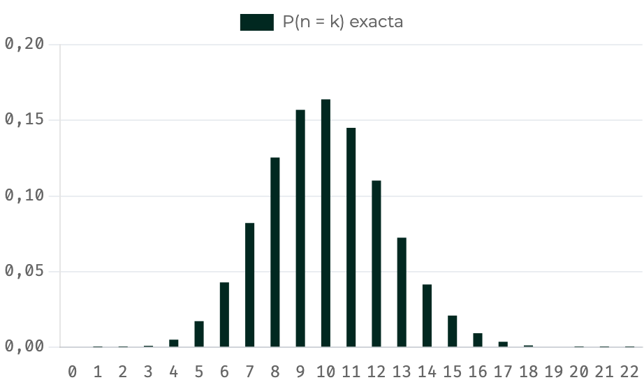
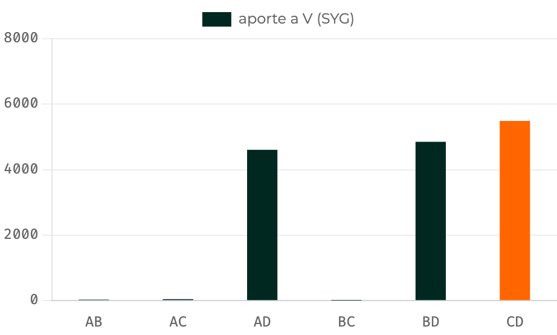
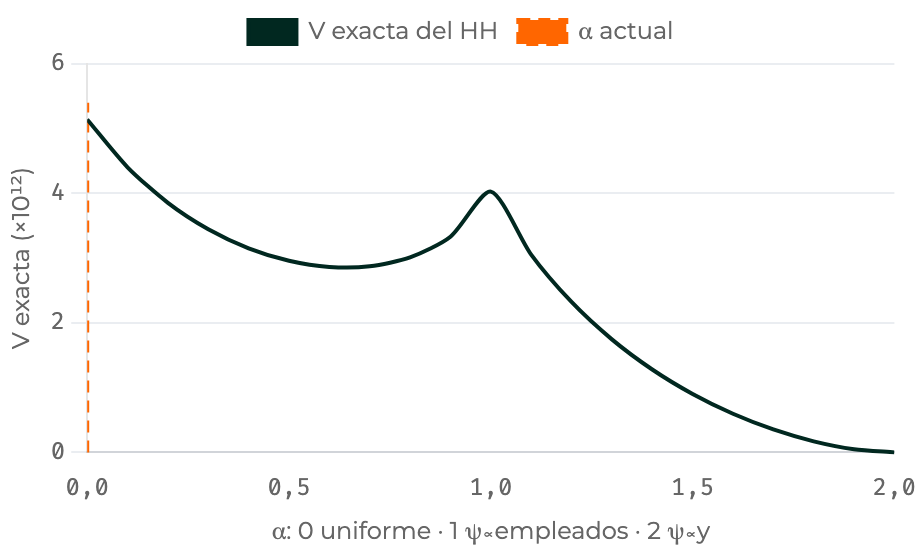

<!--
  Capítulo 6, sesión 2 de 2 (semana 13 del sílabo): módulos 6 a 10, para 90 min de exposición.
  La sesión 1 (semana 12) cubre los módulos 1 a 5. Mismas convenciones: fuente visible al pie (los
  nombres internos, en las notas), <mark>Dato</mark>, <kbd>Lectura</kbd>, caja «Opinión del material» y
  caja «Ejemplo ilustrativo» para las cifras elegidas o las poblaciones inventadas.

  Gráficos animados de esta sesión: el elefante (módulo 8) y los pesos de classes (módulo 9). Los genera
  precalculo/genera_diapositivas_cap6.py desde cap6_datos.json; las fotos de los simuladores,
  precalculo/fotografia_simuladores_cap6.py (T7.113).

  El código proyectado sale de los bloques del capítulo, recortado (se dice en las notas); sus salidas son
  las publicadas, que verifica_bloques.py contrasta con la ejecución.
-->

# El diseño de Poisson {seccion=modulo-6}

> Una moneda distinta para cada unidad: el diseño más fácil de sortear y de analizar, a cambio de no saber cuántas unidades saldrán.

???
Minuto 0. Pregunta de arranque: ¿cómo se sortea una muestra de transacciones que todavía no han ocurrido?

## Lo que traemos de la sesión 1

- Dividir entre la probabilidad de salir deja **insesgado** el sorteo; la varianza es pequeña si \(y_k/\pi_k\) cambia poco
- \(\psi\): una extracción, suma 1; \(\pi\): estar en la muestra, suma \(n\)
- \(\pi_{kl}\): probabilidad de que \(k\) y \(l\) salgan juntas; \(\Delta_{kl} = \pi_{kl} - \pi_k\pi_l\) (capítulo 2)
- πPT: \(\pi_k = n\,x_k/t_x\), con inclusión forzosa si pasa de 1
- **Correlación no es proporcionalidad:** con counties el πPT pierde; con waterarea, por un solo estado

Las mismas marcas: <mark>Dato</mark>, <kbd>Lectura</kbd> y «Opinión del material».

???
Repaso de dos minutos. Si alguien no estuvo en la sesión 1, su diapositiva 4 explica las marcas. Los divisores de hoy van de 01 a 05: en el capítulo son los módulos 6 a 10, que es lo que dicen las fuentes al pie. Los bloques de código son una sola sesión de R; el pie de cada código dice qué objetos toma de bloques anteriores. Cerrar el repaso con la pregunta de las transacciones, que contesta la diapositiva siguiente.

## Poisson: cada unidad lanza su propia moneda

::: flujo
1. **Fijar** — la probabilidad de inclusión \(\pi_k\) de cada unidad
2. **Sortear** — un uniforme \(\varepsilon_k\) por unidad, independiente de los demás
3. **Decidir** — la unidad entra si \(\varepsilon_k < \pi_k\)
:::

- Sirve para marcos que **llegan**: transacciones auditadas al ocurrir, paquetes de una red
- Es el Bernoulli del capítulo 2 con una moneda distinta para cada unidad

<small>Fuente: cap. 6, módulo 6 (algoritmo); Gutiérrez, §4.1.</small>

???
Cada unidad se decide en el momento, sin conocer las que vendrán. Ningún diseño de tamaño fijo puede decidir así, de forma definitiva, cada unidad al llegar: los que hay para flujos, como el muestreo de reservorio, deciden de forma provisional y pueden sacar después una unidad de la muestra. El nombre viene de los «ensayos de Poisson», ensayos de Bernoulli independientes con probabilidades distintas; no tiene que ver con la distribución de Poisson. California, con \(\pi = 1\), es una moneda que siempre sale cara.

## El tamaño de muestra es aleatorio: con los estados, \(n_s = 10\) solo el 16 % de las veces {columnas=3:2}



|||

::: ejemplo Ejemplo ilustrativo (dos monedas)
Con \(\pi_1 = 0{,}3\) y \(\pi_2 = 0{,}5\): \(P(n_s = 0) = 0{,}35\), \(P(n_s = 1) = 0{,}5\) y \(P(n_s = 2) = 0{,}15\).
:::

- <mark>Dato</mark> estados: \(E(n_s) = 10\), desviación 2,41
- <mark>Dato</mark> \(P(9 \le n_s \le 11) = 0{,}466\)

<small>Fuente: cap. 6, módulo 6, bloque «Poisson sobre statepps con varianza exacta» (las dos pestañas) y su simulador.</small>

???
Con monedas independientes las probabilidades se multiplican: \(0{,}7 \times 0{,}5\), \(0{,}3 \times 0{,}5 + 0{,}7 \times 0{,}5\) y \(0{,}3 \times 0{,}5\). Con 51 monedas, la pestaña Python hace lo mismo moneda por moneda (programación dinámica). La leyenda de la foto dice \(n\); es el \(n_s\) del título. En vivo, el deslizador del simulador multiplica todas las \(\pi\): preguntar qué le pasa al cv de \(n_s\) si el presupuesto baja a la mitad.

## Con \(\pi_{kl} = \pi_k\pi_l\), la independencia da la varianza más simple

$$V(\hat{t}_\pi) = \sum_{k \in U}\left(\frac{1}{\pi_k} - 1\right) y_k^2 \qquad\qquad \widehat{V}(\hat{t}_\pi) = \sum_{k \in s} (1 - \pi_k)\,\frac{y_k^2}{\pi_k^2}$$

- Con monedas independientes, \(\pi_{kl} = \pi_k\pi_l\): de la doble suma solo queda la diagonal
- \(E(n_s) = \sum \pi_k\) y \(V(n_s) = \sum \pi_k(1 - \pi_k)\)

<small>Fuente: cap. 6, módulo 6 (fórmula); Gutiérrez, §4.1.</small>

???
\(\Delta_{kl} = \pi_{kl} - \pi_k\pi_l\) es la covarianza de las indicadoras, y en Poisson vale 0. \(V\) suma sobre toda la población; su estimador, solo sobre la muestra, con \(\pi_k^2\) abajo. Es la varianza más simple del capítulo, y vuelve en el módulo 8: deja ver el elefante término a término.

## Con esta semilla salieron 8 estados, y el HT quedó a menos de un error estándar {columnas=3:2}

```r Poisson con los estados: n aleatorio y varianza exacta
set.seed(2026)
s_poi <- rbinom(nrow(statepps), 1, pi_st) == 1
c(n_obtenido = sum(s_poi), E_n = sum(pi_st),
  de_n = sqrt(sum(pi_st * (1 - pi_st))))
#> n_obtenido        E_n       de_n
#>   8.000000  10.000000   2.414976
c(t_HT = sum(statepps$counties[s_poi] / pi_st[s_poi]))
#>     t_HT
#> 1896.203
c(V_exacta = sum((1 - pi_st) * statepps$counties^2 / pi_st),
  ee = sqrt(sum((1 - pi_st) * statepps$counties^2 / pi_st)))
#>    V_exacta          ee
#> 1604348.622    1266.629
```

|||

- <mark>Dato</mark> HT de 1896 condados, frente a un total de 3143
- <mark>Dato</mark> varianza exacta 1 604 349: error estándar de 1267
- <kbd>Lectura</kbd> lejos, pero dentro de lo esperable con este diseño

<small>Fuente: cap. 6, módulo 6, bloque «Poisson sobre statepps con varianza exacta» (pestaña R, sin las dos monedas). Usa `statepps` y `pi_st`, del módulo 5.</small>

???
Proyectar. Recortado: se quitan los comentarios y la cuenta de las dos monedas. Usa las \(\pi\) del módulo 5 (\(n = 10\), California forzosa). La diferencia, 3143 − 1896 = 1247, es menos de un error estándar. `rbinom(51, 1, π)` es la moneda de la diapositiva del algoritmo con otro flujo de números: con la misma semilla da 8 estados, y `runif(51) < π` da 15, la primera de las cinco muestras del bloque del módulo 6. Las dos son Poisson; solo cambia qué números consume cada una.

## Con \(\pi_k = n\,y_k/t\), ¿qué pasa con la varianza del HT de Poisson? {.pregunta}

Aquí \(n = E(n_s)\) es el tamaño esperado.

1. No es cero: cada unidad aporta \(t/n\), así que el HT vale \(t\,n_s/n\) y cambia con \(n_s\)
2. Es cero, porque los cocientes \(y_k/\pi_k\) son todos iguales
3. No se puede calcular: Poisson no tiene \(\pi_{kl}\)

::: respuesta
La 1. Los cocientes sí son iguales, como dice la 2, pero el HT los suma sobre la muestra, y el número de sumandos es aleatorio. La 3 falla: Poisson sí tiene \(\pi_{kl}\), las más simples, \(\pi_k\pi_l\).
:::

<small>Fuente: cap. 6, módulo 11, pregunta 9 de la autoevaluación.</small>

???
**Uso:** un minuto, por escrito; después, revelar. Lo esperable es que muchos digan «cero». Son tres de las cuatro opciones del material. La idea central del capítulo da varianza cero solo con tamaño fijo. La diapositiva siguiente lo muestra con los estados. La pregunta 8, numérica, sale de aquí: con las 51 \(\pi\) iguales a 10/51, \(V(n_s) = 8{,}04\), frente a 5,83 con \(\pi \propto\) población.

## Con \(\pi \propto y\), el HT de Poisson solo depende de cuántas unidades salen

$$\pi_k = n\,\frac{y_k}{t} \quad\Longrightarrow\quad \hat{t}_\pi = \frac{t}{n}\,n_s$$

- <mark>Dato</mark> con \(y\) = población: 10 estados aciertan; 15 se pasan un 49 %; 8 se quedan en el 80,5 %
- **Remedio**, con \(\pi \propto x\): la razón del capítulo 3, \(t_x\,\hat{t}_{y,\pi}/\hat{t}_{x,\pi}\), cancela la fracción \(n_s/n\)
- <mark>Dato</mark> counties, 20 000 muestras simuladas: el error cuadrático medio (ECM) baja de 1 574 244 a 773 791

<small>Fuente: cap. 6, módulo 6, bloque «Poisson con pi proporcional a y, y la corrección de razón»; Gutiérrez, §4.1.3.</small>

???
Con tamaño fijo esas \(\pi\) darían varianza cero; con Poisson, todo el error viene del tamaño aleatorio. No es exactamente 50 % y 80 % porque California entra siempre y aporta lo mismo en todas las muestras. El corrector de Gutiérrez, \(N\,\hat{t}_{y,\pi}/\hat{N}_\pi\), deja el ECM en 959 401. La razón queda cerca de los diseños de tamaño fijo del módulo 5, a cambio de un sesgo pequeño (capítulo 3). La varianza exacta del HT es 1 604 349; el ECM de 1 574 244 es su versión simulada.

## Poisson paga su \(n\) aleatorio: deff 3,51, y con la razón, 1,69

| Diseño, \(n = 10\) estados | Varianza | deff |
|---|---|---|
| πPT sistemático, lista por población | 344 951 | 0,75 |
| MAS sin reemplazo | 456 975 | 1 |
| πPT sistemático, lista alfabética | 575 401 | 1,26 |
| πPT de Tillé, sin \(\pi_{kl}\) nulas | 697 273 | 1,53 |
| Poisson con el estimador de razón (ECM) | 773 791 | 1,69 |
| Hansen–Hurwitz, \(\psi \propto\) población | 963 006 | 2,11 |
| Poisson, el HT | 1 604 349 | 3,51 |

Total de condados. **deff:** la varianza entre la del MAS sin reemplazo. Todas exactas, salvo el ECM de la razón (20 000 muestras simuladas).

<small>Fuente: cap. 6, módulo 6, tabla «Diez diseños para el mismo total, con el mismo n» (siete de sus diez filas).</small>

???
Solo el sistemático con la lista ordenada le gana al MAS sin reemplazo. El de Tillé es un πPT de tamaño fijo con todas las \(\pi_{kl}\) positivas; está en el «Para profundizar» del módulo 5 y no se expone. Faltan tres filas de la tabla del material: el MAS con reemplazo (557 287; 1,22), Brewer (715 020; 1,56, con 4000 réplicas) y el de máxima entropía (723 607; 1,58). Las cifras son `disenosCounties` de `cap6_datos.json`. El ejercicio 4 compara Poisson con el sistemático: no hacer aquí esa cuenta. Transición: varianzas exactas como estas solo existen cuando se conoce la población; con una muestra, hay que estimarlas.

# Estimar la varianza del HT {seccion=modulo-7}

> Estimar el total pide las \(\pi\); estimar su varianza pide además las \(\pi_{kl}\), las probabilidades de que cada par salga junto.

???
Minuto 22. Pregunta de arranque: el HT suma términos \((y_k/\pi_k)\,I_k\); ¿qué hace falta saber de dos indicadoras para la varianza de una suma?

## La varianza del HT se puede escribir de dos maneras

$$V(\hat{t}_\pi) = \sum_{k \in U}\sum_{l \in U} \Delta_{kl}\,\frac{y_k}{\pi_k}\,\frac{y_l}{\pi_l} \qquad \Delta_{kl} = \pi_{kl} - \pi_k\pi_l$$

$$V(\hat{t}_\pi) = \sum_{k < l} (\pi_k\pi_l - \pi_{kl})\left(\frac{y_k}{\pi_k} - \frac{y_l}{\pi_l}\right)^2$$

- La primera es la **forma HT**; la segunda, la de **Sen–Yates–Grundy** (SYG), solo para tamaño fijo
- Con tamaño fijo, \(\pi_{kl}\) suele ser menor que \(\pi_k\pi_l\): si entra \(k\), quedan menos cupos para \(l\)

<small>Fuente: cap. 6, módulo 7 (fórmula); Gutiérrez, Resultado 4.3.1; Lohr 3.ª ed., §6.4.1.</small>

???
Son la misma varianza escrita de dos maneras. \(\pi_k\pi_l - \pi_{kl}\) mide cuánto se excluyen las dos unidades; en Poisson vale 0. SYG apareció en el capítulo 2, módulo 3.

## Con las tiendas, los pares con D aportan casi toda la varianza {columnas=3:2}



|||

- <mark>Dato</mark> la forma SYG reproduce la varianza exacta del diseño del módulo 4: 15 026
- <kbd>Lectura</kbd> no porque su primer factor sea grande, sino porque \(y_D/\pi_D\) queda lejos de los demás cocientes

<small>Fuente: cap. 6, módulo 7, bloque «La matriz pi_kl del diseño pequeño y el SYG» y su simulador.</small>

???
Cada barra es \((\pi_k\pi_l - \pi_{kl})(y_k/\pi_k - y_l/\pi_l)^2\). En los tres pares con D el primer factor es menor que en los otros tres. El módulo 4 cargaba las tres cuartas partes de la varianza a las muestras sin D, y aquí casi toda va a los pares con D: no se contradicen, son dos maneras de repartir la misma suma (entre muestras o entre pares). Las dos señalan que el cociente de D queda demasiado lejos.

## Estimada con una muestra, la forma HT puede salir negativa; SYG, en este diseño, no

| Muestra | AB | AC | AD | BC | BD | CD |
|---|---|---|---|---|---|---|
| SYG | 523 | 564 | 20 093 | 16 | 19 414 | 20 258 |
| Forma HT | −2342 | −1241 | 22 860 | −1360 | 20 182 | 18 952 |

- Cada par de la muestra se divide entre \(\pi_{kl}\): es el HT aplicado a los pares
- <mark>Dato</mark> promediadas con \(p(s)\), las dos dan 15 026: son insesgadas
- SYG no puede salir negativa si \(\pi_k\pi_l \ge \pi_{kl}\) en todos los pares (condición de Yates–Grundy)

<small>Fuente: cap. 6, módulo 7, bloque «Los dos estimadores de la varianza en las seis muestras».</small>

???
Las dos son insesgadas si todas las \(\pi_{kl}\) son positivas; la de SYG, además, solo con tamaño fijo. En la forma HT, el término de \(k = l\) es \((1 - \pi_k)\,y_k^2/\pi_k^2\). Una varianza negativa no tiene sentido, y aquí sale en tres de las seis muestras.

## agpps: con las mismas \(\pi_{kl}\), la forma HT da un error estándar seis veces mayor {columnas=3:2}

```r survey con la matriz de conjuntas (pps = ppsmat)
dis_yg <- svydesign(id = ~1, fpc = ~SelectionProb, data = agpps,
                    pps = ppsmat(Pmat), variance = "YG")
svytotal(~acres92, dis_yg)
#>             total       SE
#> acres92 936291173 11715204
dis_ht <- svydesign(id = ~1, fpc = ~SelectionProb, data = agpps,
                    pps = ppsmat(Pmat), variance = "HT")
svytotal(~acres92, dis_ht)
#>             total       SE
#> acres92 936291173 70466698
```

|||

- **Los datos:** 15 condados sorteados con \(\pi \propto\) acres de 1987, con la matriz 15 × 15 de \(\pi_{kl}\); se estiman los acres de 1992: 936 millones
- <mark>Dato</mark> error estándar con SYG: 11,7 millones de acres; con la forma HT: 70,5 millones
- <mark>Dato</mark> con la aproximación con reemplazo, sin ninguna \(\pi_{kl}\): 12,3 millones

<small>Fuente: cap. 6, módulo 7, bloques «agpps: forma HT y forma SYG a mano» y «survey con ppsmat reproduce ambos»; Lohr 3.ª ed., ej. 6.10. Usa `agpps` y `Pmat`, de los bloques anteriores del módulo 7.</small>

???
Proyectar. `Pmat` lo arma el bloque anterior del material: las columnas `JtProb` del archivo como matriz, con la diagonal sustituida por las \(\pi\) (`diag(Pmat) <- agpps$SelectionProb`); en el archivo la diagonal vale 0, y sin ese paso `survey` devuelve `NaN`. El archivo trae algo que casi ningún archivo trae. Con SYG, el intervalo es 936,3 ± 23 millones de acres, y el total verdadero de agpop (capítulo 1), 943 951 718, cae dentro. La aproximación con reemplazo queda cerca de SYG; se explica dos diapositivas más adelante.

## Mismos datos, mismas \(\pi_{kl}\), errores estándar de 70,5 y 11,7 millones: ¿qué pasa? {.pregunta}

1. La forma HT está mal programada: deberían dar lo mismo
2. SYG subestima: el verdadero es el de la forma HT, que usa todos los términos
3. La forma HT suma términos de signos opuestos que casi se cancelan; SYG suma solo positivos

::: respuesta
La 3. `survey` reproduce las dos cifras: no hay error de programación, son dos estimadores distintos de la misma varianza. La forma HT ni siquiera se anula cuando todos los \(y_k/\pi_k\) son iguales, y SYG sí: el ejercicio 3 lo comprueba.
:::

<small>Fuente: cap. 6, módulo 11, pregunta 10 de la autoevaluación.</small>

???
**Uso:** un minuto, voto a mano alzada; después, revelar. La tentación es la 1, el error de programación. Lohr (§6.4.1 y ej. 6.10) señala la forma HT como la errática. Son tres de las cuatro opciones del material. Un error estándar de 70 millones implicaría un cv de cerca del 7,5 % para un diseño construido para ser preciso. La cuarta opción del material dice que SYG deja fuera los términos de \(k = l\): no, los absorbe al escribir la suma con diferencias al cuadrado. Cuenta propia, que no está en el capítulo: con `acres87`, la variable con que se hicieron las \(\pi\), la forma HT da un ee de 71,6 millones y SYG, de 1,24 acres. Es el ejercicio 3: no decir las cifras.

## Casi nunca hay \(\pi_{kl}\): se estima como si fuera con reemplazo

$$\psi_k = \frac{\pi_k}{n}, \qquad z_k = \frac{y_k}{\psi_k} = \frac{n\,y_k}{\pi_k}, \qquad \widehat{V} = \frac{s_z^2}{n}$$

- Es el Hansen–Hurwitz de la sesión 1, con \(\pi \approx n\,\psi\); las unidades forzosas quedan fuera
- **Conservadora** cuando el sorteo sin reemplazo es más eficiente, lo habitual: sobrestima, y el exceso crece con \(n/N\)
- <mark>Dato</mark> en los estados (\(n/N = 0{,}2\)), su esperanza es 1,53 veces la varianza verdadera del sistemático

<small>Fuente: cap. 6, módulo 7 (aproximación con reemplazo); Lohr 3.ª ed., ec. 6.24.</small>

???
Lohr la recomienda en general. Con cientos de UPM, el exceso se vuelve despreciable; por eso las encuestas reales declaran sus UPM «con reemplazo» (capítulo 7). Así se estimó el error estándar del sistemático en el módulo 5 (unos 1005). El «Para profundizar» del módulo 7 trae la aproximación de Hájek–Deville, más fina y también sin \(\pi_{kl}\): con los estados, 726 308 frente a la exacta de 723 607; no se expone.

## Qué estimador usar depende de lo que se sepa del diseño

| Situación | Estimador de la varianza |
|---|---|
| Tamaño fijo y \(\pi_{kl}\) conocidas | SYG |
| Tamaño aleatorio, como Poisson | Forma HT (en Poisson, la del módulo 6) |
| \(\pi_{kl}\) desconocidas, el caso habitual | Aproximación con reemplazo |

<kbd>Lectura</kbd> Las encuestas reales casi nunca conocen sus \(\pi_{kl}\): la sección de dos etapas muestra cómo se apoyan en la aproximación con reemplazo.

<small>Fuente: cap. 6, módulo 7 (tabla «En resumen»).</small>

???
La tabla del material añade, en la última fila, la de Hájek–Deville de su «Para profundizar». El sistemático ni siquiera tiene todas sus \(\pi_{kl}\) positivas. Transición: con tamaño fijo y todo bien estimado, ¿puede el HT seguir siendo un mal estimador?

# Cuándo el HT se comporta mal {seccion=modulo-8}

> Insesgado no quiere decir útil: una unidad con un valor enorme y una \(\pi\) pequeña basta para arruinar el estimador.

???
Minuto 42. El módulo 5 lo anticipa: con `waterarea`, el πPT pierde (deff 9) por un solo estado, Alaska, con una \(\pi\) de 0,023 y el 36 % del agua del país. Salió en la sesión 1: recordarlo en una frase.

## Bajo Poisson, cada unidad aporta \((1/\pi_k - 1)\,y_k^2\) a la varianza

$$V(\hat{t}_\pi) = \sum_{k \in U}\left(\frac{1}{\pi_k} - 1\right) y_k^2$$

Con tamaño fijo la fórmula es otra, pero el mecanismo es el mismo.

::: ejemplo Ejemplo ilustrativo (Basu, 1971; una sola extracción)
Un circo pesa uno de sus 50 elefantes: el mediano sale con probabilidad 99/100 y cada uno de los otros, con 1/4900. Si sale el mediano, el HT da 100/99 de su peso; si sale otro, 4900 veces el suyo.
:::

<kbd>Lectura</kbd> Insesgado, y absurdo con cualquier muestra.

<small>Fuente: cap. 6, módulo 8; Lohr 3.ª ed., §6.7.</small>

???
Es la varianza de Poisson del módulo 6, la más simple, que deja ver el problema término a término. El título no da la respuesta a propósito: la pregunta llega después de los veinte negocios. El total buscado son unas 50 veces el peso de un elefante: con el mediano se queda casi 50 veces corto, con otro se pasa casi 100 veces. Si \(\pi_k = 1\), el término vale cero.

## Veinte negocios y un elefante con el área mínima y el 82 % de las ventas

::: ejemplo Ejemplo ilustrativo (población simulada en el bloque del módulo 8)
20 negocios con ventas proporcionales al área, salvo uno: el «elefante», con el área mínima (empatada con otros dos) y 8790 de las 10 726 ventas. Con \(\pi \propto\) área y \(n = 5\), le toca \(\pi = 0{,}0649\).
:::

- <mark>Dato</mark> el 93,5 % de las veces no sale, y el HT ve, más o menos, el resto: 1936
- <mark>Dato</mark> cuando sale, su término \(y/\pi\) vale 135 366, más de doce veces el total
- <kbd>Lectura</kbd> en promedio da el total, pero casi nunca se acerca a él

<small>Fuente: cap. 6, módulo 8, bloque «La curva de la varianza explosiva» (semilla 2026).</small>

???
Es la tienda D del módulo 1 al revés: allí el área anticipaba las ventas; aquí las contradice. El HT oscila entre dos mundos.

## El elefante pone el 99,95 % de la varianza: ¿por qué? {.pregunta}

1. Porque su \(y\) es el 82 % del total: cualquier diseño sufriría igual
2. Por la combinación de \(y\) grande y \(\pi\) pequeña
3. Porque su \(\pi\) es pequeña: con cualquier \(y\), daría el mismo aporte

::: respuesta
La 2. Con \(\pi = 1\) su aporte sería cero, porque \(1/\pi - 1\) se anula: no es solo su \(y\) (la 1). Con un \(y\) pequeño, sería pequeño aunque \(\pi\) lo fuera: no es solo su \(\pi\) (la 3). Y la \(\pi\) la elige el diseñador.
:::

<small>Fuente: cap. 6, módulo 11, pregunta 11 de la autoevaluación.</small>

???
**Uso:** un minuto, por escrito, razonando con la fórmula de Poisson; después, revelar. Son tres de las cuatro opciones del material, sin su gráfico: en el material la pregunta se hace sobre el gráfico de aportes con la \(\pi\) del elefante en 0,02. Aquí va antes del gráfico, y la diapositiva siguiente lo muestra moviendo su \(\pi\).

## Subir la \(\pi\) del elefante hunde la varianza; con \(\pi = 1\), su término vale cero {columnas=3:2}

{alto=400}

|||

- <mark>Dato</mark> bajar su \(\pi\) a 0,005 multiplica la varianza por 13,8
- <mark>Dato</mark> con \(\pi = 0{,}5\), la varianza es unas 200 veces menor que con 0,005
- <kbd>Lectura</kbd> con \(\pi = 1\), su término desaparece: la \(\pi\) la elige el diseñador

<small>Fuente: cap. 6, módulo 8, bloque «La curva de la varianza explosiva» y simulador «El elefante y su π».</small>

???
Cuatro pasos: la curva, el punto de su \(\pi\) por área (1113 millones), el de 0,005 (15 376 millones) y el de 0,5 (78 millones). El material dice «casi 200»: 15 376/78. El eje está en porcentaje para que se lea; el simulador del material lo dibuja en escala logarítmica, aporte por aporte. La curva es la fórmula de la diapositiva con `elefante.y` y `piBase` de `cap6_datos.json`, en una malla densa que pasa por los ocho puntos de `elefante.malla`.

## El elefante se evita antes, al diseñar, al estimar o después

::: warn Opinión del material · cuatro defensas, según el momento
::: flujo
1. **Antes de muestrear** — tamaños al día: el elefante suele nacer de una medida desactualizada
2. **Al diseñar** — inclusión forzosa: \(\pi_k = 1\) ante la sospecha
3. **Al estimar** — la razón (capítulo 3), si hay una auxiliar que sí acompañe a \(y\)
4. **Después** — recortar el peso, a cambio de un pequeño sesgo (capítulo 7)
:::
:::

<small>Fuente: cap. 6, módulo 8 (advertencia «Cuatro defensas, según el momento»); Lohr 3.ª ed., §6.7.</small>

???
Son reglas prácticas del autor, ordenadas por el momento en que se aplican. Lohr cierra así la historia de Basu: con el peso de cada elefante hace tres años, conocido para los 50, el estimador de razón es razonable salga el que salga. No salva el ejemplo de los 20 negocios: allí la auxiliar sería la misma área que no anticipa las ventas del elefante.

## Borrar la observación rara no es una defensa contra el elefante {.idea etiqueta="Idea clave · opinión del material"}

La unidad es legítima: el problema fue el diseño que le dio una \(\pi\) pequeña.

???
Cierra la advertencia del módulo 8. El mismo problema aparece en ciencia de datos con pesos \(1/\psi\) y \(\psi\) muy pequeñas: lo retoma la última sección.

# PPT en dos etapas {seccion=modulo-9}

> Clases grandes con más probabilidad de salir y el mismo número de estudiantes en cada una: todos acaban con el mismo peso.

???
Minuto 56. En el capítulo 5, las escuelas se sorteaban con probabilidades iguales y los pesos quedaban muy desiguales (40,9 a 137,6 en schools). Aquí se arregla sorteando las UPM con PPT.

## classes: 5 de 15 clases con PPT y 4 estudiantes en cada una

- **El marco:** `classes`, 15 clases de estadística; la clase \(i\) tiene \(M_i\) estudiantes, y \(K = 647\) en total. \(M_i\) es la medida de tamaño (la \(x_k\) de antes) y \(K\) su total (la \(t_x\))
- **Etapa 1:** \(n = 5\) clases sin reemplazo, con \(\pi_i = 5\,M_i/K\)
- **Etapa 2:** \(m = 4\) estudiantes en cada clase sorteada, con probabilidad \(4/M_i\)
- **La muestra:** `classpps`, con las horas que cada estudiante dedica a estadística

<small>Fuente: cap. 6, módulo 9; classes.csv y classpps.csv; Lohr 3.ª ed., Tabla 6.2 (el marco, ej. 6.2) y ej. 6.11 (la muestra).</small>

???
\(M_i\) y \(K\) se escriben como en el capítulo 5. Salieron las clases 1, 4, 9, 10 y 14. Lohr no dice con qué algoritmo las sorteó; con esas \(\pi\) serviría cualquiera de los del módulo 5. Una clase grande tiene más probabilidad de salir y, dentro de ella, cada estudiante tiene menos, en la misma proporción.

## ¿Qué peso tiene un estudiante de la clase de 100? ¿Y de la de 22? {.pregunta}

Su probabilidad es la de su clase por la suya dentro de ella; el peso es el inverso.

::: respuesta
Los dos, \(647/20 = 32{,}35\): \(\dfrac{5 \cdot 100}{647}\cdot\dfrac{4}{100} = \dfrac{5 \cdot 22}{647}\cdot\dfrac{4}{22} = \dfrac{20}{647} = 0{,}0309\). El \(M_i\) se cancela.
:::

<small>Fuente: cap. 6, módulo 9 (la probabilidad de cada estudiante); las clases 14 (M = 100) y 4 (M = 22) están en classpps.</small>

???
**Uso:** dos minutos, en papel; después, revelar. Quien termine pronto, que pruebe con la clase 1 (M = 44). Es la cuenta que el módulo 9 hace en general. La diapositiva siguiente lo muestra para las 15 clases del marco y lo contrasta con el sorteo de probabilidades iguales.

## Con PPT y \(m\) fijo, todos los estudiantes pesan lo mismo {columnas=3:2}

{alto=400}

|||

- <mark>Dato</mark> con probabilidades iguales, un estudiante de la clase de 100 pesa 6,7 veces uno de la de 15
- <mark>Dato</mark> con PPT y \(m = 4\): 32,35 en las 15 clases

::: definicion Diseño autoponderado
Todas las unidades observadas tienen el mismo peso: \(w = \dfrac{K}{nM_i}\cdot\dfrac{M_i}{m} = \dfrac{K}{nm}\).
:::

<small>Fuente: cap. 6, módulo 9 (definición y simulador «La cancelación, en vivo»); classes.csv.</small>

???
Dos pasos: primero las barras con probabilidades iguales, \(w = (N/n)\,M_i/m = 0{,}75\,M_i\), de 11,25 a 75; después la línea de 32,35. Las barras usan las fórmulas del simulador. Contra las clases sorteadas, la razón es 4,5 (la de 100 frente a la de 22). Con un peso común, la media estimada es la media simple de los datos.

## Cada clase estima el total, y la varianza sale de su dispersión {columnas=3:2}

```r HH de dos etapas y su versión con survey
z <- por_clase$t_hat / por_clase$psi
round(z, 1)
#> [1] 2264.5 3235.0 2345.4 2021.9 1294.0
c(t_HH = mean(z), ee = sqrt(var(z) / 5))
#>      t_HH        ee
#> 2232.1500  311.7624
dis_cl <- svydesign(id = ~class, weights = ~finalweight,
                    data = classpps)
svytotal(~hours, dis_cl)
#>        total     SE
#> hours 2232.2 311.76
unique(classpps$finalweight)
#> [1] 32.35
```

|||

- \(z_i = \hat{t}_i/\psi_i = 647\,\bar{y}_i\), con \(\psi_i = \pi_i/5 = M_i/647\)
- <mark>Dato</mark> clase 14: \(M = 100\), \(\bar{y} = 2{,}0\) horas, \(z = 1294\)
- <mark>Dato</mark> total de horas 2232,15, con error estándar (ee) de 311,8

<small>Fuente: cap. 6, módulo 9, bloques «HH de dos etapas a mano» y «survey y el diseño autoponderado» (recortados); Lohr 3.ª ed., ec. 6.30. Usa `por_clase`, del primer bloque del módulo, y `classpps`.</small>

???
Proyectar. `por_clase` lo arma el primer bloque del módulo, con \(M_i\), \(\bar{y}_i\) y \(\hat{t}_i = M_i\,\bar{y}_i\) de cada clase; la línea de `svydesign` se partió en dos. Las clases se sortearon sin reemplazo, pero se analizan como si fuera con reemplazo: la dispersión de los \(z_i\) entre clases recoge las dos etapas a la vez. Con \(n/N = 5/15\), Lohr advierte que este ee probablemente sobrestima. La media es 3,45 horas (ee 0,48). Para cerrar, la pregunta 12 del material: ¿por qué pesan todos exactamente 32,35? Es estructura, no suerte, y `survey` usa los pesos tal como llegan (en schools, capítulo 5, siguen dispares).

## Muchas encuestas grandes en persona sortean sus unidades primarias con PPT

- Las **UPM**, unidades primarias de muestreo, son las que se sortean primero: aquí, las clases
- Lohr, ej. 6.12: la encuesta de seroprevalencia de COVID-19 en España sorteó secciones censales con PPT y 24 hogares en cada una
- <kbd>Lectura</kbd> dentro de cada estrato, muestra casi autoponderada, y la misma carga de trabajo, conocida de antemano, en cada sección
- Gutiérrez da el mismo motivo: fijar las entrevistas por UPM controla el trabajo de campo

<small>Fuente: cap. 6, módulo 9; Lohr 3.ª ed., ej. 6.12; Gutiérrez, §7.3.1.</small>

???
Lo de la encuesta española no se recalcula: es lo que cuenta Lohr, por eso no lleva Dato. Analizar las UPM como si se hubieran sorteado con reemplazo, y estimar la varianza solo con la dispersión entre ellas, es la base de las encuestas complejas: en esa literatura se llama «conglomerado último» (*ultimate cluster*), y el capítulo 7 (módulo 1) lo usa con los totales de las UPM dentro de cada estrato.

# Importancia y active learning {seccion=modulo-10}

> El Hansen–Hurwitz de la sesión 1 se usa fuera de las encuestas con otro nombre: muestreo por importancia.

???
Minuto 70. Pregunta de arranque: ¿qué tiene que ver sortear estados con estimar una integral por Monte Carlo?

## El PPT con reemplazo es el muestreo por importancia

| Encuestas (este capítulo) | Muestreo por importancia |
|---|---|
| unidad \(i\) del marco | punto \(u_i\) donde se evalúa la función |
| valor \(y_i\) | \(f(u_i)\) |
| probabilidad de extracción \(\psi_i\) | la «propuesta» |
| peso \(1/(n\,\psi_i)\) | peso de importancia |
| Hansen–Hurwitz, \(\dfrac{1}{n}\sum y_i/\psi_i\) | estimador por importancia |

<kbd>Lectura</kbd> La propuesta ideal, \(\psi_i = y_i/t\), da varianza cero, pero exige conocer \(y\).

<mark>Dato</mark> Con los estados, para el total de condados, la propuesta \(\psi \propto\) población da 963 006, y la uniforme, 557 287: lo que anticipaba Raj.

<small>Fuente: cap. 6, módulo 10 (tabla de traducción y bloque «Tres propuestas y sus varianzas exactas»).</small>

???
Con \(y \ge 0\) y \(\psi_i = y_i/t\), cada extracción da \(y_i/\psi_i = t\): siempre la misma cifra. Es la idea central del módulo 1 llevada al extremo. En la práctica se busca una \(\psi\) parecida a \(y\) con una variable barata que se conozca para todas las unidades. La tabla del material tiene una fila más: el total \(t\), que en importancia es la suma o la integral de \(f\). El bloque de las tres propuestas añade la tercera, \(\psi \propto\) condados, la propia \(y\), con varianza 0; las otras dos son las del criterio de Raj de la sesión 1, con 10 extracciones: una correlación de 0,46 con la población no basta.

## BigLucy: mezclar la propuesta con algo de uniforme le gana a la propuesta sola {columnas=3:2}



|||

- **Los datos:** 85 296 empresas ficticias; se estima el ingreso con 100 extracciones
- \(\alpha\) mezcla las propuestas: 0, uniforme; 1, \(\psi \propto\) empleados; 2, \(\psi \propto\) ingreso
- <mark>Dato</mark> \(\alpha = 0{,}6\): 1,8 veces menos varianza que la uniforme; \(\alpha = 1\): 1,3 veces
- <kbd>Lectura</kbd> la recta del ingreso sobre los empleados corta el eje en 99,9, el 23 % de su media

<small>Fuente: cap. 6, módulo 10 (simulador «El camino hacia la propuesta perfecta»); BigLucy (`TeachingSampling`), que Gutiérrez, §4.2.4, usa con el ingreso como tamaño.</small>

???
Abrir el simulador desde el divisor y mover \(\alpha\): en 0, la varianza es 5,1 × 10¹²; en 0,6, 2,9 × 10¹², el mínimo de la malla; en 1, sube a 4,0 × 10¹²; de 1 a 2 cae a cero, pero ese tramo exige conocer el ingreso. La correlación de los empleados con el ingreso es 0,64, y aun así la propuesta sola mejora poco: una empresa pequeña tiene más ingreso por empleado que una grande. No hay un elefante; la varianza está repartida entre miles de empresas. La parte uniforme hace el papel de ese intercepto. Es la **mezcla defensiva** (*defensive mixture*): pone un piso a las \(\psi\) y un techo a los pesos \(1/\psi\), como la inclusión forzosa del módulo 8.

## Active learning: con pesos \(1/\psi\), la tasa de error sale insesgada

::: ejemplo Ejemplo ilustrativo (datos simulados en el bloque del módulo 10)
Un modelo clasifica 10 000 imágenes y hay presupuesto para etiquetar 100, sorteadas con \(\psi\) proporcional a la duda del modelo, mezclada con un 10 % de uniforme. Tasa de error verdadera: 0,162.
:::

| 2000 repeticiones | Promedio | Desviación |
|---|---|---|
| sin pesos | 0,288 | 0,046 |
| con pesos \(1/\psi\) (HH) | 0,162 | 0,033 |
| MAS con reemplazo | 0,162 | 0,036 |

<small>Fuente: cap. 6, módulo 10, bloque «Active learning: la tasa de error con y sin pesos» (semilla 2026).</small>

???
Sin pesos, la muestra está llena de imágenes difíciles y la tasa sale casi al doble. Con pesos es insesgada y algo más precisa que el MAS. En la práctica, las etiquetas que elige el *active learning* sirven para reentrenar; si con ellas mismas se mide el error, el modelo parece mejor de lo que es. El *replay* priorizado del aprendizaje por refuerzo y la evaluación *off-policy* usan el mismo esquema, y pesos con \(\psi\) muy pequeñas reproducen el elefante.

## Sobre muestreo por importancia, ¿qué es cierto? {.pregunta etiqueta="Pregunta para la clase · varias respuestas"}

1. La propuesta \(\psi \propto y\) tiene varianza cero, pero exige conocer \(y\)
2. Si los datos se recogieron sin registrar las \(\psi\), basta ponderar después
3. Una propuesta con correlación 0,46 con \(y\) puede ser peor que la uniforme
4. Con cualquier \(\psi\) conocida y positiva, el estimador es insesgado

::: respuesta
Todas menos la 2: una \(\psi\) que nadie anotó no se puede invertir. La 1, la 3 y la 4 son el resumen de la sección.
:::

<small>Fuente: cap. 6, módulo 11, pregunta 13 de la autoevaluación.</small>

???
**Uso:** dos minutos, marcar en papel; después, revelar. Es de repaso: cuatro afirmaciones sobre lo visto en esta sección; esperar el desacuerdo en la 2. Son las cuatro opciones del material, en otro orden, y es la última pregunta de su autoevaluación.

## La condición que no se negocia: \(\psi\) conocida y positiva {.idea etiqueta="Idea clave · advertencia del material"}

Una unidad con \(\psi = 0\) no entra en ninguna estimación, y un conjunto de datos recogido «según llegaba» no tiene \(\psi\) conocida: ninguna ponderación posterior lo arregla del todo.

???
Es el sesgo de selección del capítulo 1. Ponderar después (capítulo 8) es una reparación aproximada, no una garantía.

# Cierre del capítulo 6 {seccion=modulo-11}

???
Minuto 85.

## Lo que te llevas del capítulo {.cierre}

- Poisson regala la varianza más simple, a cambio de un \(n\) aleatorio que la razón corrige
- La varianza del HT pide \(\pi_{kl}\); sin ellas, la aproximación **con reemplazo**, conservadora
- El elefante es \(y\) grande con \(\pi\) pequeña: se evita **al diseñar**, no borrando datos
- PPT arriba y \(m\) fijo abajo: diseño **autoponderado**, el de las encuestas de hogares
- En ciencia de datos, pesos \(1/\psi\) con \(\psi\) **conocida y positiva**

???
Retomar las dos sesiones con la idea central: la varianza es pequeña cuando \(y_k/\pi_k\) cambia poco. El capítulo 7 junta estratos, conglomerados y probabilidades desiguales en las encuestas complejas.

## Para la próxima semana

::: flujo
1. **Autoevaluación** — rehaz sin mirar las seis últimas; la 8 no se vio en clase
2. **Ejercicio guiado 3** — SYG con agpps y acres87: ¿por qué sale casi cero?
3. **Ejercicio guiado 4** — Poisson frente al sistemático, con counties y waterarea
4. **Ejercicios 5 y 6** — Gutiérrez §4.5, a mano y con el código que lo comprueba
5. **Hacia el capítulo 7** — estratos, UPM con PPT, submuestreo y pesos ajustados, todo a la vez
:::

<small>Fuente: cap. 6, módulo 11 (autoevaluación, ejercicios guiados y «Hacia el capítulo 7»).</small>

???
El ejercicio 3 es el πPT en estado puro, con la variable con la que se construyeron las \(\pi\): anunciarlo sin dar el resultado. El 4 compara las dos varianzas exactas: tampoco adelantar la cifra. Los ejercicios 5 y 6 se pueden hacer a mano; sus soluciones corren solas. El capítulo 7 responde la pregunta que el software hace inevitable: cómo se estima la varianza cuando el diseño es todo eso a la vez y nadie conoce las \(\pi_{kl}\).
